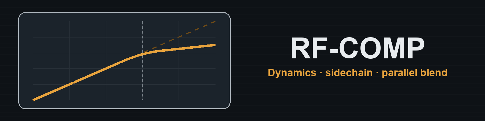

# RF-Comp

RF-Comp is a stereo compressor for RackForge. Use it to soften loud accents, make a performance more even, or add weight by blending a compressed signal with the original.

## Install

RF-Comp is included in the RackForge Standard bundle. To install it separately, download `RF-Comp.rfplugin` and choose **Install plugin** in RackForge's **Plugin Manager**. [Download RF-Comp](https://github.com/kalexis1994/rackforge-plugin-rf-comp/releases/latest)

## Start with a preset

Open the instrument's **Effects** in PLAY and choose **Add effect → RF-Comp**. Try **Piano Glue** for gentle leveling, **Peak Tamer** to catch louder accents, or **Parallel Crush** for a more pronounced effect.

## Set it by ear

1. Play your loudest phrase and lower **Threshold** until the gain reduction meter moves on the notes you want to control. Raise **Ratio** for stronger compression above that level. **Knee** softens the transition into compression and **Range** limits how much gain can be taken away.
2. Shorten **Attack** to catch more of the initial hit, or lengthen it to keep that hit audible. Set **Release** so the gain recovers in time for the next phrase, or try **Auto Release**.
3. Toggle **Bypass** and use **Makeup** to match the processed and dry levels. Reduce **Mix** to bring some of the original dynamics back.

Choose **Peak** detection for short accents or **RMS** for a response based on average signal level. If bass notes make the rest of the sound dip, raise the sidechain high-pass cutoff and use **Sidechain Listen** to hear what the detector receives. **Stereo Link** makes both channels respond together and helps keep the stereo image steady.

## License

RF-Comp is distributed under GPL-3.0-only. [License](LICENSE) · [Notices](NOTICE.md)
